# Estatística visual: 45 gráficos com dados reais, cada um com a sua leitura

Uma galeria de gráficos estatísticos em Python. Cada um responde a uma pergunta concreta com dados públicos reais (e-commerce da Olist, Airbnb em Buenos Aires, churn de telecom, avaliações de filmes) e vem com **a leitura do resultado** e **quando usar** aquele tipo de gráfico.

**Destaques:**
- Sankey, diagrama de cordas, alluvial, treemap (squarify), nuvem de palavras e horizon chart **implementados do zero** em matplotlib, sem bibliotecas prontas para eles;
- todos os números das leituras são calculados pelo próprio script na hora de gerar o gráfico; nenhum foi digitado à mão;
- uma seção **Errado × certo**, com o mesmo dado mostrado de forma enganosa e de forma honesta;
- um padrão visual único: paleta validada para daltonismo, título com a conclusão, subtítulo com o que foi medido e fonte no rodapé.

## Índice

| # | Gráfico | Pergunta |
|---|---|---|
| 01 | [Raincloud](#01-raincloud) | Quanto tempo leva uma entrega da Olist em cada região do país? |
| 02 | [Ridgeline](#02-ridgeline) | Como o preço da diária do Airbnb varia entre os bairros de Buenos Aires? |
| 03 | [Beeswarm](#03-beeswarm) | Clientes que cancelaram pagavam mensalidades diferentes dos que ficaram? |
| 04 | [Distribuição acumulada (ECDF)](#04-distribuicao-acumulada-ecdf) | Em quantos dias a Olist consegue entregar 90% dos pedidos em cada região? |
| 05 | [Gráfico Q-Q](#05-grafico-q-q) | O valor dos pedidos segue uma distribuição normal? E o logaritmo do valor? |
| 06 | [Violino](#06-violino) | Há quanto tempo estão na operadora os clientes de cada tipo de contrato? |
| 07 | [Histograma e a escolha de bins](#07-histograma-e-a-escolha-de-bins) | Qual é a forma da distribuição dos preços do Airbnb, e quanto a escolha dos intervalos interfere? |
| 08 | [Dumbbell](#08-dumbbell) | Em cada estado, quanto o prazo prometido pela Olist difere do prazo real de entrega? |
| 09 | [Lollipop divergente](#09-lollipop-divergente) | Quais categorias têm nota acima ou abaixo da média da loja? |
| 10 | [Slope chart](#10-slope-chart) | A participação de cada região nos pedidos mudou entre 2017 e 2018? |
| 11 | [Bump chart](#11-bump-chart) | Como mudou, trimestre a trimestre, o ranking das categorias que mais faturam? |
| 12 | [Pequenos múltiplos](#12-pequenos-multiplos) | Quais gêneros de filme ganharam e perderam espaço nas avaliações publicadas no Twitter? |
| 13 | [Barras divergentes (Likert)](#13-barras-divergentes-likert) | Como se distribuem as notas de 1 a 5 em cada categoria, e onde estão as insatisfeitas? |
| 14 | [Treemap](#14-treemap) | Como o faturamento da Olist se divide entre as categorias de produto? |
| 15 | [Waffle](#15-waffle) | Como os clientes pagam os pedidos da Olist? |
| 16 | [Marimekko](#16-marimekko) | A forma de pagamento muda entre as regiões, levando em conta o tamanho de cada região? |
| 17 | [Área empilhada 100%](#17-area-empilhada-100) | A mistura de formas de pagamento mudou ao longo de 2017 e 2018? |
| 18 | [UpSet](#18-upset) | Quais combinações de serviços extras os clientes de internet contratam, e quais cancelam menos? |
| 19 | [Sankey](#19-sankey) | De que região saem os pedidos da Olist e para que região eles vão? |
| 20 | [Alluvial](#20-alluvial) | Por quais combinações de contrato e internet passam os clientes que cancelam? |
| 21 | [Funil](#21-funil) | Em qual etapa, da compra à avaliação nota 5, a Olist perde mais pedidos? |
| 22 | [Diagrama de cordas](#22-diagrama-de-cordas) | Entre os maiores estados, quem vende para quem? |
| 23 | [Hexbin](#23-hexbin) | Quanto o frete pesa em relação ao valor do produto, pedido a pedido? |
| 24 | [Matriz de correlação agrupada](#24-matriz-de-correlacao-agrupada) | Quais características dos clientes andam juntas, e quais andam com o cancelamento? |
| 25 | [Coordenadas paralelas](#25-coordenadas-paralelas) | Qual é o perfil, em várias medidas ao mesmo tempo, dos clientes que cancelam? |
| 26 | [Rede de coocorrência](#26-rede-de-coocorrencia) | Quais gêneros de filme costumam aparecer juntos? |
| 27 | [Mapa de hexágonos](#27-mapa-de-hexagonos) | Onde ficam os anúncios mais caros do Airbnb em Buenos Aires? |
| 28 | [Bolhas](#28-bolhas) | Estados com entrega mais demorada dão notas mais baixas? |
| 29 | [Heatmap de calendário](#29-heatmap-de-calendario) | Em quais dias de 2017 a Olist vendeu mais? |
| 30 | [Streamgraph](#30-streamgraph) | Como o volume de avaliações de cada gênero evoluiu de 2013 a 2021? |
| 31 | [Horizon chart](#31-horizon-chart) | Quando cada região vendeu acima ou abaixo do seu próprio ritmo normal? |
| 32 | [Fan chart (leque de incerteza)](#32-fan-chart-leque-de-incerteza) | Quantos pedidos esperar nas próximas 12 semanas, e com quanta incerteza? |
| 33 | [Decomposição de série temporal](#33-decomposicao-de-serie-temporal) | Quanto da variação diária das vendas é tendência, quanto é dia da semana e quanto é imprevisível? |
| 34 | [Heatmap radial (relógio)](#34-heatmap-radial-relogio) | Em que horas e dias da semana os clientes compram? |
| 35 | [Nuvem de palavras](#35-nuvem-de-palavras) | Que palavras os clientes insatisfeitos mais usam? |
| 36 | [Log-odds de palavras](#36-log-odds-de-palavras) | Quais palavras são típicas de avaliações negativas, e não só frequentes? |
| 37 | [Forest plot](#37-forest-plot) | Quais características aumentam ou reduzem a chance de cancelar, descontando as outras? |
| 38 | [Distribuição de bootstrap](#38-distribuicao-de-bootstrap) | Quanto um imóvel inteiro custa a mais que um quarto privativo, e com que precisão sabemos isso? |
| 39 | [Funnel plot](#39-funnel-plot) | Quais vendedores atrasam mais do que o acaso explicaria, dado o seu volume? |
| 40 | [Lei de Benford](#40-lei-de-benford) | Os valores pagos na Olist seguem a Lei de Benford, como se espera de dados financeiros não manipulados? |
| 41 | [Diagnóstico de resíduos](#41-diagnostico-de-residuos) | Uma regressão linear para o preço do Airbnb cumpre as suposições que dão validade aos intervalos de confiança? |
| 42 | [Cobertura de intervalos de confiança](#42-cobertura-de-intervalos-de-confianca) | Se repetíssemos uma pesquisa 100 vezes, quantos intervalos de 95% conteriam o valor verdadeiro? |
| 43 | [Pizza × barras](#43-pizza--barras) | Qual a participação de cada categoria nos pedidos, e qual gráfico responde isso melhor? |
| 44 | [Eixo duplo × índice](#44-eixo-duplo--indice) | Pedidos e ticket médio cresceram juntos? |
| 45 | [Eixo truncado](#45-eixo-truncado) | A nota média muda muito entre as regiões? |

## Distribuição

*Como os valores se espalham: forma, caudas e diferenças entre grupos.*

### 01 Raincloud

**Pergunta:** Quanto tempo leva uma entrega da Olist em cada região do país?

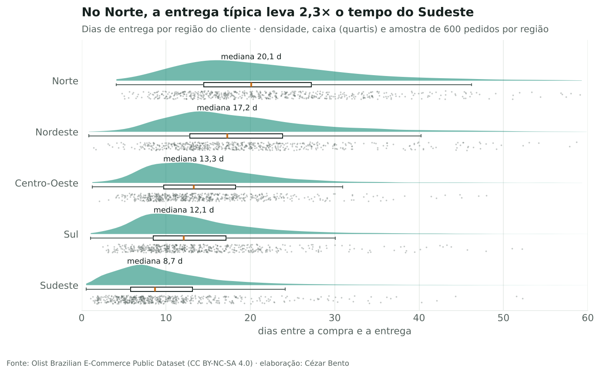

**Leitura:** A mediana vai de 8,7 dias no Sudeste a 20,1 no Norte. A cauda também muda: 10% dos pedidos do Norte levam mais de 35 dias, contra 19 no Sudeste. Um box plot sozinho esconderia que todas as distribuições são assimétricas à direita, com caudas longas.

**Quando usar:** Comparar distribuições inteiras entre poucos grupos, mostrando forma, resumo e os dados brutos de uma vez.

[Código](graficos/01_raincloud.py)

### 02 Ridgeline

**Pergunta:** Como o preço da diária do Airbnb varia entre os bairros de Buenos Aires?

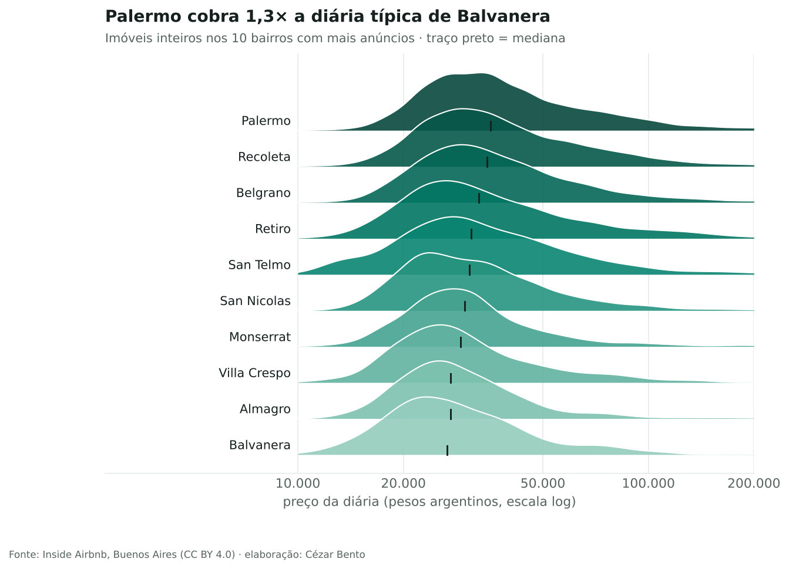

**Leitura:** Os bairros estão ordenados pela mediana: de Balvanera (ARS 26.601) a Palermo (ARS 35.511). As curvas se sobrepõem muito: o bairro desloca o preço, mas a variação dentro de cada bairro é maior que a diferença entre eles. A escala log é necessária porque preço é multiplicativo: sem ela, a cauda dos anúncios caros esmagaria todas as curvas à esquerda.

**Quando usar:** Comparar a forma da distribuição entre muitos grupos (8 a 20) sem gastar um painel por grupo.

[Código](graficos/02_ridgeline.py)

### 03 Beeswarm

**Pergunta:** Clientes que cancelaram pagavam mensalidades diferentes dos que ficaram?

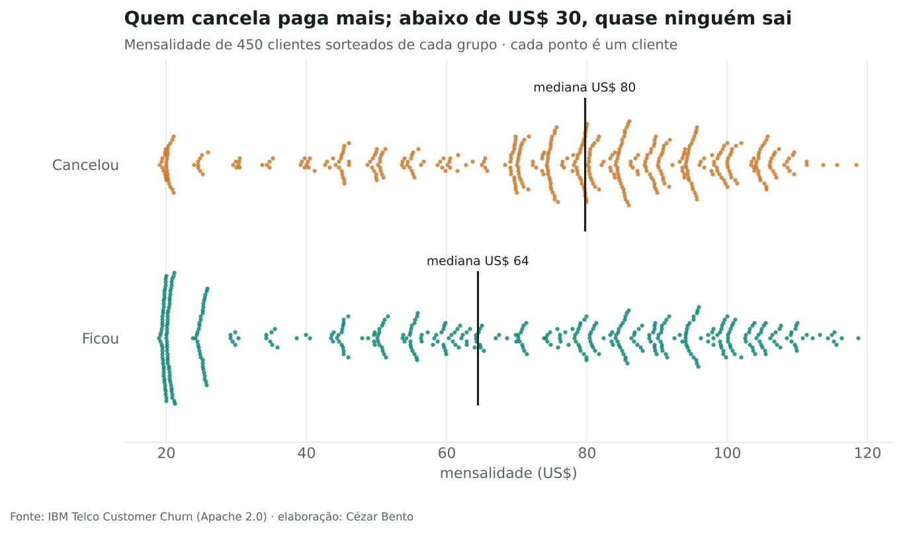

**Leitura:** A mediana de quem cancelou é US$ 80, contra US$ 64 de quem ficou. O enxame mostra o que a média esconde: a distribuição de quem fica é bimodal, com um bloco grande abaixo de US$ 30 (planos sem internet), onde só 10% cancelam. Entre US$ 70 e 110, o cancelamento sobe para 37%. 29% de quem ficou paga menos de US$ 30.

**Quando usar:** Mostrar cada observação quando o número de pontos é moderado (centenas), mantendo a forma da distribuição.

[Código](graficos/03_beeswarm.py)

### 04 Distribuição acumulada (ECDF)

**Pergunta:** Em quantos dias a Olist consegue entregar 90% dos pedidos em cada região?

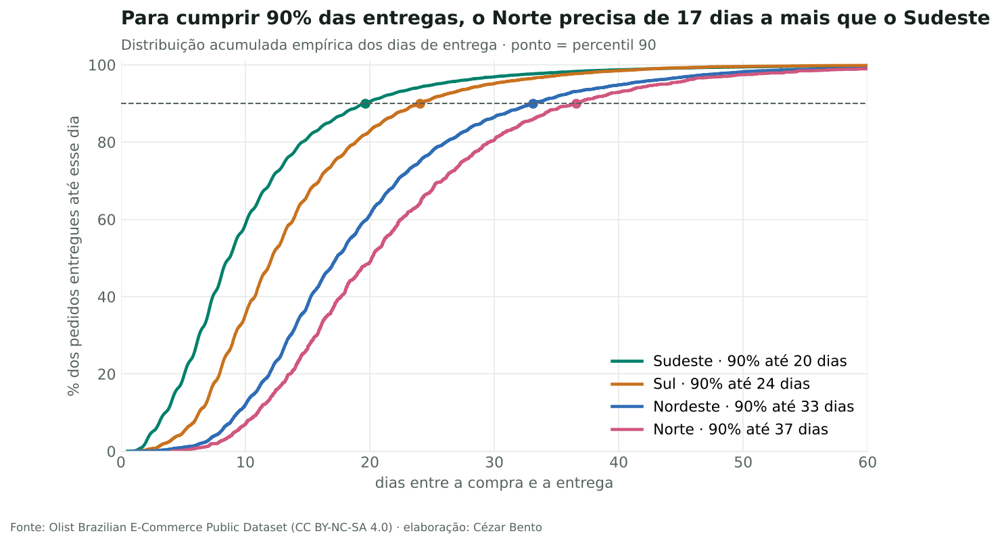

**Leitura:** Cada curva responde "qual fração dos pedidos chegou até o dia X". O percentil 90 é 20 dias no Sudeste, 24 no Sul, 33 no Nordeste e 37 no Norte. É o número certo para definir um prazo prometido: prometer pela média faria 38% dos pedidos chegarem depois.

**Quando usar:** Ler percentis direto no gráfico e comparar grupos sem depender da escolha de bins de um histograma.

[Código](graficos/04_ecdf.py)

### 05 Gráfico Q-Q

**Pergunta:** O valor dos pedidos segue uma distribuição normal? E o logaritmo do valor?

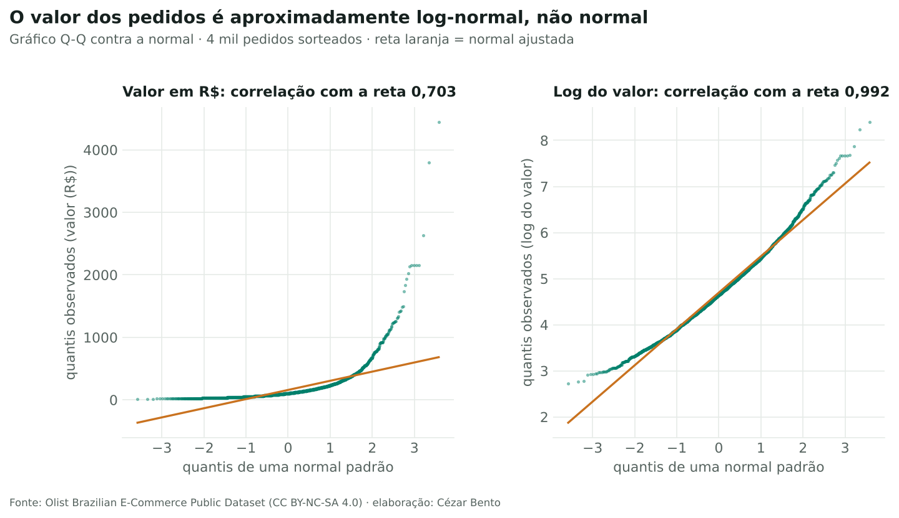

**Leitura:** No valor bruto, os pontos se curvam para cima à direita: a cauda é muito mais longa que a de uma normal (assimetria 7,2). Depois do log, os pontos seguem a reta no miolo (assimetria 0,53), com desvios só nos extremos. Consequência prática: médias e intervalos de confiança do valor devem ser calculados em log, ou com mediana e bootstrap.

**Quando usar:** Checar uma suposição de modelo (normalidade de resíduos, log-normalidade) olhando as caudas, onde os testes formais são pouco informativos.

[Código](graficos/05_qq_plot.py)

### 06 Violino

**Pergunta:** Há quanto tempo estão na operadora os clientes de cada tipo de contrato?

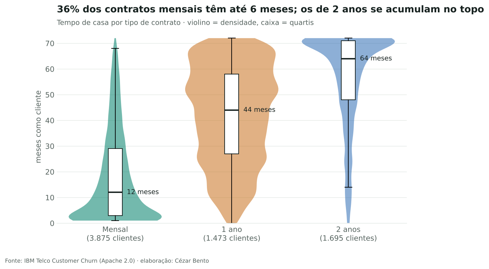

**Leitura:** Os três grupos têm formas opostas: o contrato mensal concentra clientes novos (mediana de 12 meses), o de 2 anos concentra clientes antigos (mediana de 64 meses, encostando no limite de 72 da base), e o de 1 ano é quase uniforme. Isso alerta para um viés: comparar churn por contrato mistura o efeito do contrato com o tempo de casa.

**Quando usar:** Comparar distribuições com formas diferentes (bimodais, truncadas), que um box plot faria parecer iguais.

[Código](graficos/06_violino.py)

### 07 Histograma e a escolha de bins

**Pergunta:** Qual é a forma da distribuição dos preços do Airbnb, e quanto a escolha dos intervalos interfere?

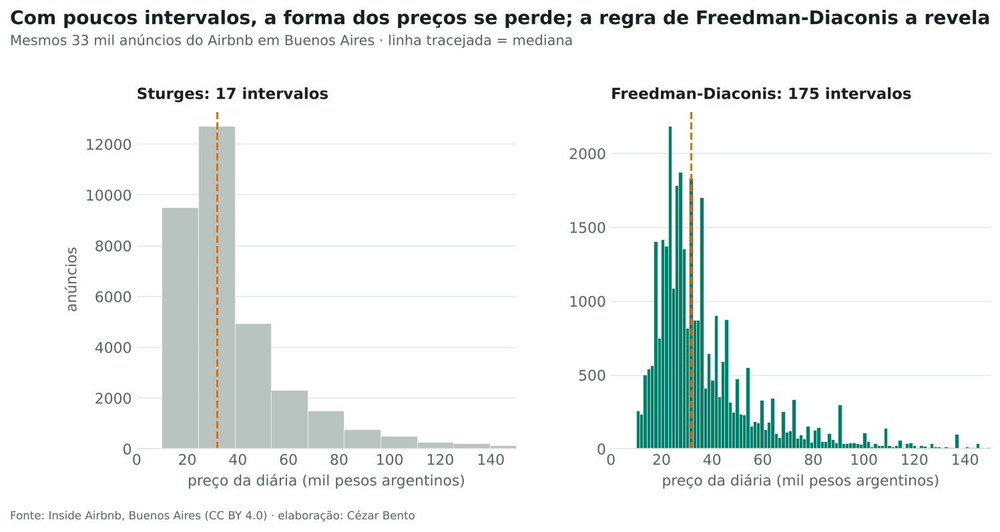

**Leitura:** A regra de Sturges (17 intervalos) foi pensada para dados normais e pequenos; aqui ela alisa demais. Freedman-Diaconis (175 intervalos) usa o intervalo interquartil e revela a assimetria forte, com a moda bem à esquerda da mediana e uma cauda longa de anúncios caros. Sem justificar a regra de bins, um histograma pode contar a história que o autor quiser.

**Quando usar:** Mostrar a forma de uma variável contínua, sempre justificando a regra de bins (Freedman-Diaconis é robusta a caudas).

[Código](graficos/07_histograma_bins.py)


## Comparação

*Quem é maior, quem mudou, quem subiu no ranking.*

### 08 Dumbbell

**Pergunta:** Em cada estado, quanto o prazo prometido pela Olist difere do prazo real de entrega?

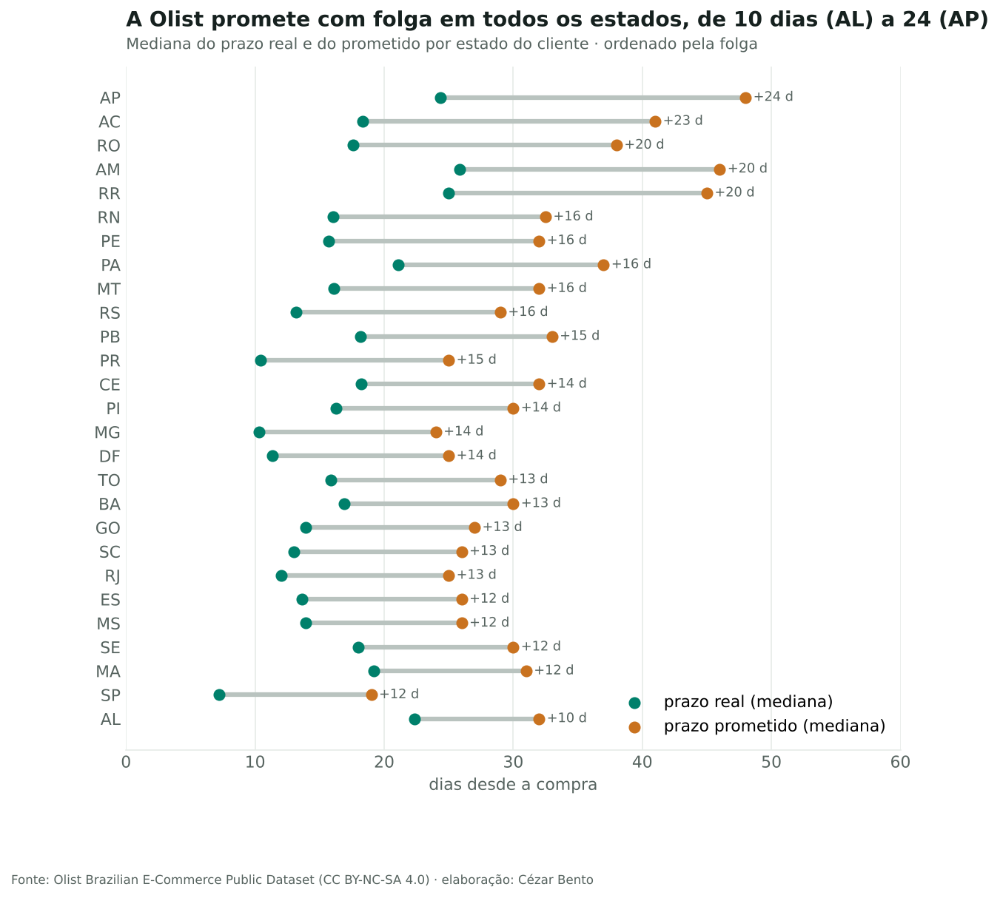

**Leitura:** Em nenhum estado a mediana real passa do prometido: a folga vai de 10 dias em AL a 24 em AP. A correlação entre o prazo real e a folga é de 0,51: estados com entrega mais lenta tendem a receber folgas maiores, mas não de forma consistente (Alagoas é lenta e tem a menor folga). A folga é margem para testar prazos prometidos menores, que tendem a aumentar a conversão.

**Quando usar:** Comparar dois valores por categoria (antes/depois, meta/real) quando o que importa é a distância entre eles.

[Código](graficos/08_dumbbell.py)

### 09 Lollipop divergente

**Pergunta:** Quais categorias têm nota acima ou abaixo da média da loja?

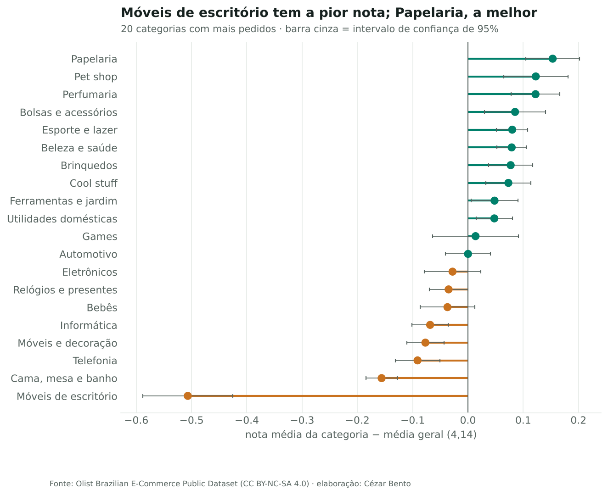

**Leitura:** A nota média geral é 4,14. Móveis de escritório fica 0,51 ponto abaixo e Papelaria, 0,15 acima. Os intervalos de confiança importam: só 15 das 20 categorias se afastam da média com segurança estatística. As outras diferenças são do tamanho do ruído.

**Quando usar:** Comparar muitas categorias contra uma referência; mais leve que barras quando os valores são parecidos.

[Código](graficos/09_lollipop_divergente.py)

### 10 Slope chart

**Pergunta:** A participação de cada região nos pedidos mudou entre 2017 e 2018?

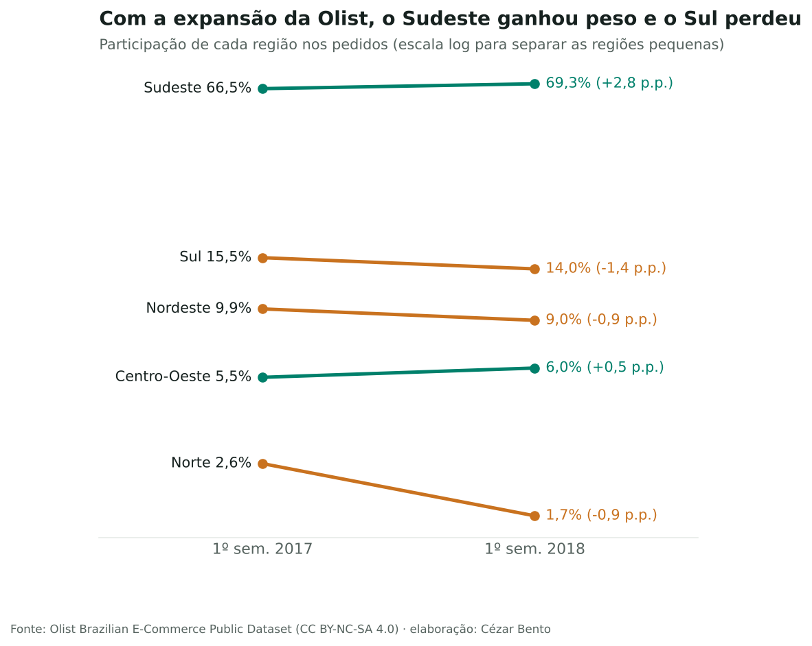

**Leitura:** O Sudeste segue dominante (69,3% em 2018), mas as linhas mostram a direção: Sudeste +2,8 p.p. e Sul -1,4 p.p. A escala log deixa visíveis as regiões pequenas; numa escala linear, Norte e Centro-Oeste ficariam espremidos no rodapé.

**Quando usar:** Mostrar a mudança de várias categorias entre dois momentos, destacando quem subiu e quem caiu.

[Código](graficos/10_slope.py)

### 11 Bump chart

**Pergunta:** Como mudou, trimestre a trimestre, o ranking das categorias que mais faturam?

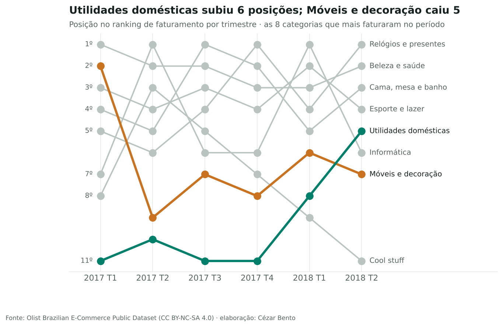

**Leitura:** O bump chart troca o valor pela posição, e com isso mostra trocas de liderança que um gráfico de linhas de faturamento esconderia sob a escala. Utilidades domésticas ganhou 6 posições entre o início de 2017 e meados de 2018; Móveis e decoração perdeu 5. A limitação: um salto de posição pode significar uma diferença pequena de receita, então o gráfico deve vir acompanhado dos valores quando a decisão depender deles.

**Quando usar:** Acompanhar posições num ranking ao longo do tempo, quando a ordem importa mais que o valor.

[Código](graficos/11_bump_chart.py)

### 12 Pequenos múltiplos

**Pergunta:** Quais gêneros de filme ganharam e perderam espaço nas avaliações publicadas no Twitter?

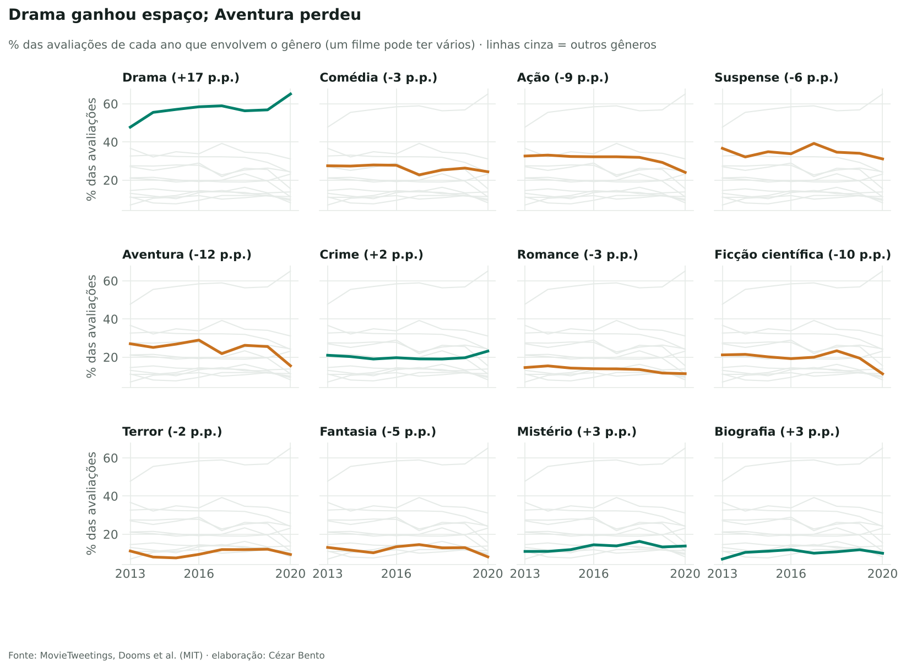

**Leitura:** Cada painel mostra um gênero contra o fundo cinza de todos os outros, com o mesmo eixo, o que permite comparar nível e tendência sem legenda. Drama variou +17 pontos percentuais entre 2013 e 2020; Aventura, -12. Como um filme pode ter vários gêneros, as porcentagens não somam 100%.

**Quando usar:** Comparar a evolução de muitas séries sem o emaranhado de linhas sobrepostas (o 'espaguete').

[Código](graficos/12_pequenos_multiplos.py)

### 13 Barras divergentes (Likert)

**Pergunta:** Como se distribuem as notas de 1 a 5 em cada categoria, e onde estão as insatisfeitas?

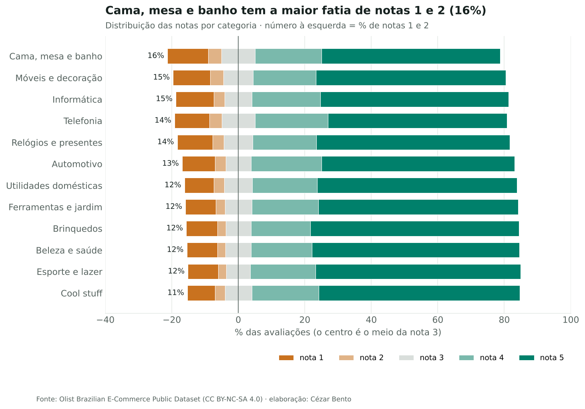

**Leitura:** Centralizar no neutro deixa o lado insatisfeito todo à esquerda, comparável entre categorias. Cama, mesa e banho tem 16% de notas 1 e 2; Cool stuff, 11%. Uma média de nota esconderia isso: duas categorias com média parecida podem ter fatias de insatisfeitos bem diferentes.

**Quando usar:** Mostrar respostas em escala ordinal (pesquisas, notas) separando o lado negativo do positivo.

[Código](graficos/13_likert_divergente.py)


## Composição

*Como um total se divide em partes.*

### 14 Treemap

**Pergunta:** Como o faturamento da Olist se divide entre as categorias de produto?

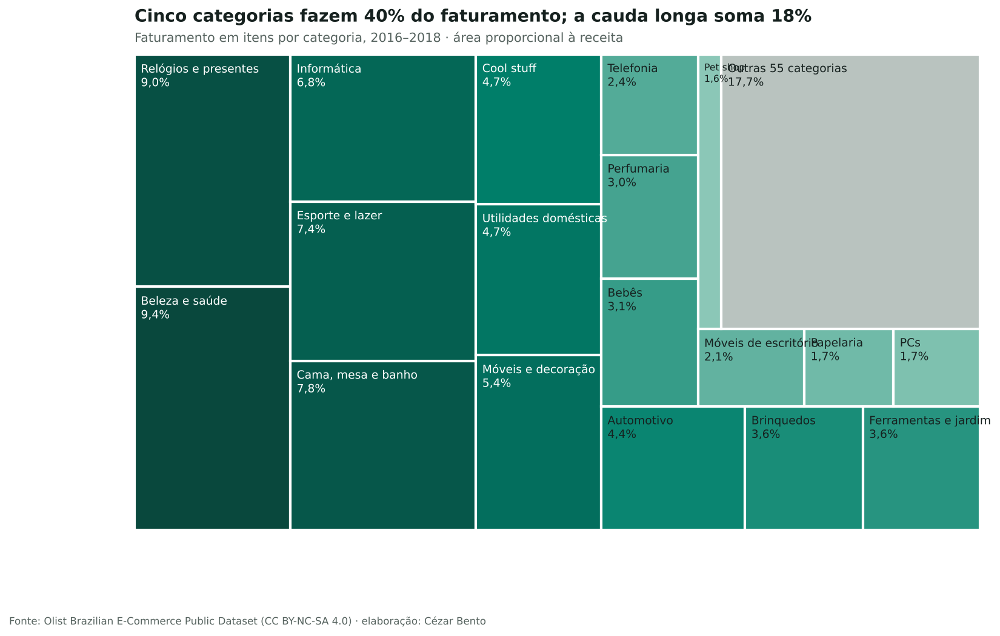

**Leitura:** Beleza e saúde lidera com 9,4% do faturamento. As cinco maiores categorias somam 40%, e as 55 menores, juntas, 18%. O algoritmo squarify (implementado do zero, sem biblioteca) mantém os retângulos próximos de quadrados, o que torna as áreas comparáveis. Para comparar valores com precisão, porém, barras ordenadas são melhores: o olho humano compara comprimentos melhor que áreas.

**Quando usar:** Mostrar a composição de um total com muitas partes (dezenas), quando a área relativa basta e a ordem exata não importa.

[Código](graficos/14_treemap.py)

### 15 Waffle

**Pergunta:** Como os clientes pagam os pedidos da Olist?

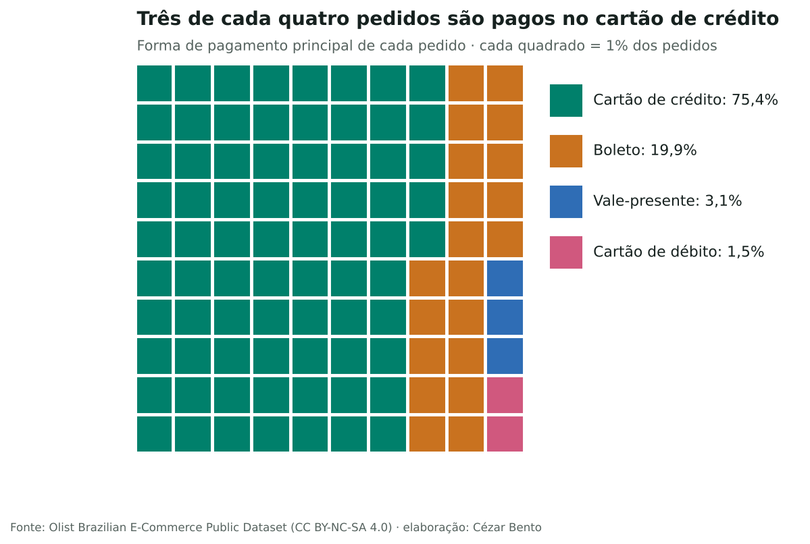

**Leitura:** Cartão de crédito responde por 75,4% dos pedidos e boleto por 19,9%. Entre os pagos no cartão, 68% são parcelados, um traço do varejo brasileiro que muda o fluxo de caixa dos vendedores. O waffle usa o arredondamento pelo maior resto para que os quadrados somem 100.

**Quando usar:** Mostrar proporções de poucas partes para públicos não técnicos; mais legível que pizza porque cada quadrado é 1%.

[Código](graficos/15_waffle.py)

### 16 Marimekko

**Pergunta:** A forma de pagamento muda entre as regiões, levando em conta o tamanho de cada região?

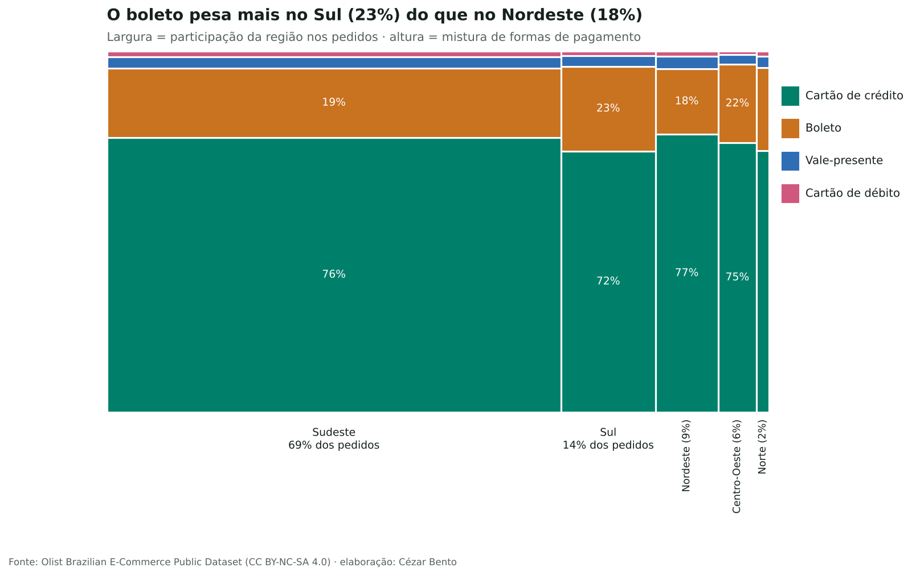

**Leitura:** A largura mostra que o Sudeste domina os pedidos (69%); a altura mostra a composição de cada região. O boleto vai de 18% no Nordeste a 23% no Sul. A diferença é pequena: a forma de pagamento quase não depende da região, e o gráfico deixa isso visível sem esconder que as regiões pequenas pesam pouco no total.

**Quando usar:** Mostrar duas variáveis categóricas ao mesmo tempo: a largura é o peso do grupo, a altura é a composição interna.

[Código](graficos/16_marimekko.py)

### 17 Área empilhada 100%

**Pergunta:** A mistura de formas de pagamento mudou ao longo de 2017 e 2018?

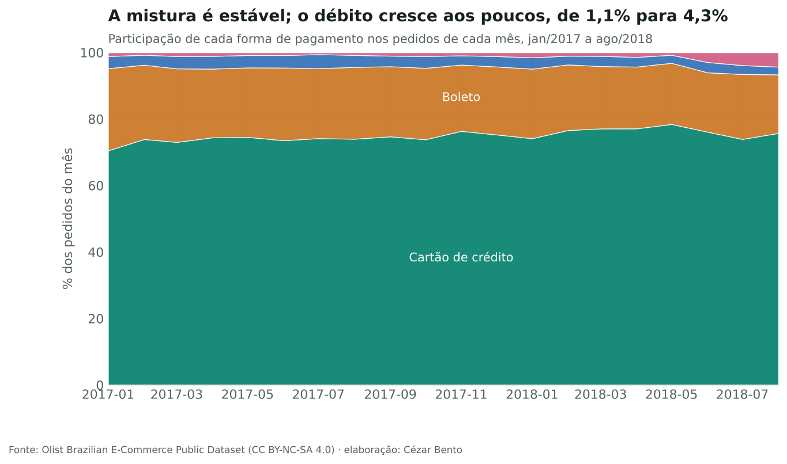

**Leitura:** Cartão de crédito oscila entre 71% e 78% e o boleto entre 18% e 25%. O cartão de débito, ainda pequeno, sobe de 1,1% para 4,3%. Cuidado de leitura: as camadas do meio não têm base fixa; para comparar o boleto entre meses, uma linha simples seria mais precisa.

**Quando usar:** Acompanhar a composição de um total no tempo; só a primeira e a última camada têm base fixa e são fáceis de ler.

[Código](graficos/17_area_100.py)

### 18 UpSet

**Pergunta:** Quais combinações de serviços extras os clientes de internet contratam, e quais cancelam menos?

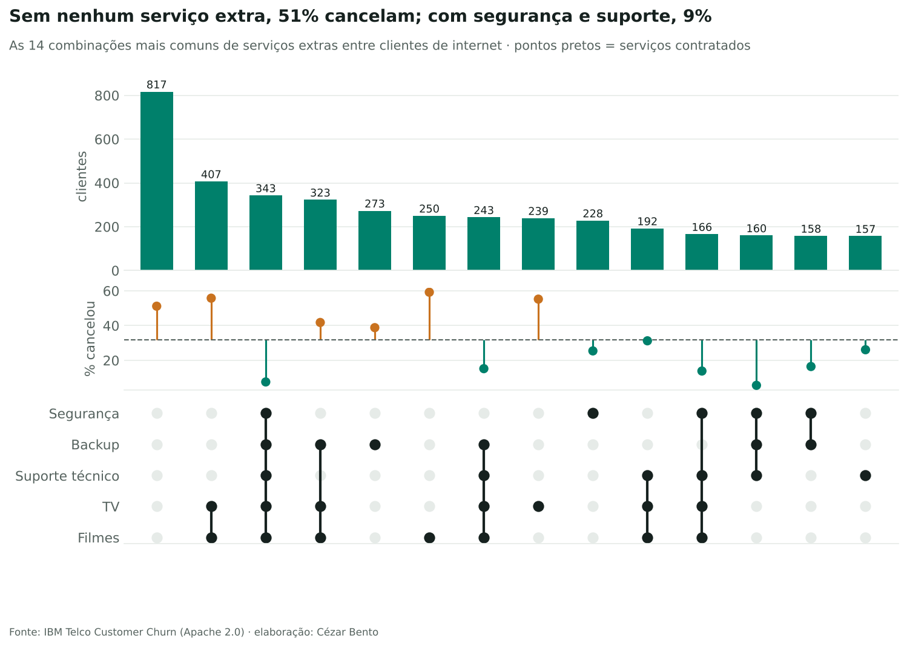

**Leitura:** A combinação mais comum é não contratar nada (817 clientes), com 51% de cancelamento, contra 32% na média. Quem contrata só streaming cancela ainda mais: com apenas Filmes, chega a 59%. Combinações com segurança online e suporte técnico cancelam bem menos (9%). Com cinco serviços, um diagrama de Venn teria 31 regiões; o UpSet lista as combinações como colunas e ainda permite pendurar uma métrica (aqui, o cancelamento) em cada uma. É associação, não causa: quem contrata mais serviços já é um cliente mais engajado.

**Quando usar:** Mostrar interseções entre mais de 3 conjuntos, onde um diagrama de Venn fica ilegível.

[Código](graficos/18_upset.py)


## Fluxo

*De onde vem e para onde vai: caminhos, etapas e trocas.*

### 19 Sankey

**Pergunta:** De que região saem os pedidos da Olist e para que região eles vão?

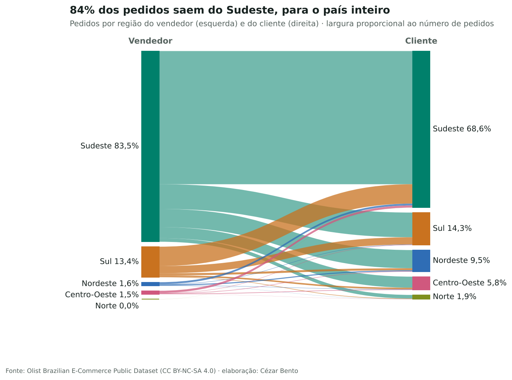

**Leitura:** O lado esquerdo mostra a concentração da oferta: 84% dos pedidos têm vendedor no Sudeste, que responde por 69% da demanda. Dos pedidos do Nordeste, 95% vêm de outra região, o que explica parte dos prazos maiores (veja o raincloud e a ECDF). O Sankey foi desenhado do zero com curvas de Bézier: cada fita começa e termina com a mesma largura, o volume do fluxo.

**Quando usar:** Mostrar fluxos entre dois ou mais estágios, com a largura proporcional ao volume.

[Código](graficos/19_sankey.py)

### 20 Alluvial

**Pergunta:** Por quais combinações de contrato e internet passam os clientes que cancelam?

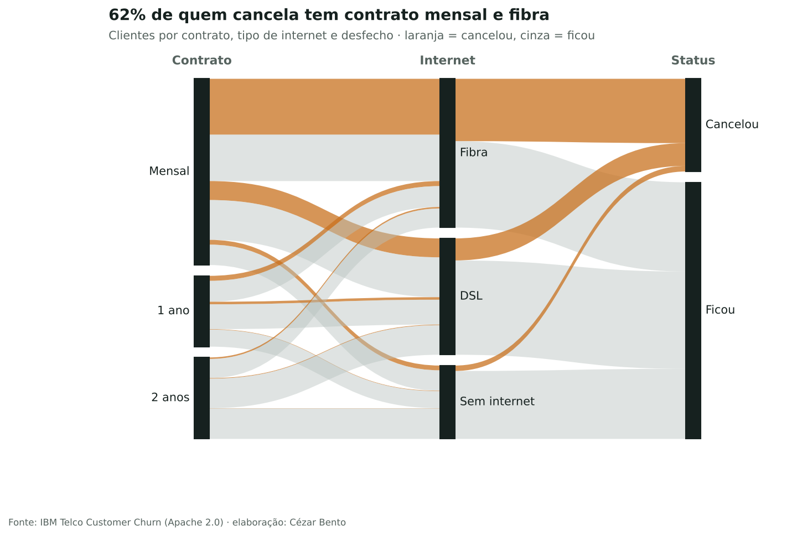

**Leitura:** Colorir as fitas pelo desfecho final permite seguir quem cancelou desde a primeira etapa. O caminho contrato mensal → fibra concentra 62% dos cancelamentos, e nesse grupo 55% dos clientes cancelaram. Contratos de 2 anos quase não têm fitas laranjas. É a mesma informação de uma tabela cruzada de três dimensões, mas a hierarquia dos fluxos aparece de imediato.

**Quando usar:** Seguir indivíduos por três ou mais classificações sucessivas e ver onde os caminhos se concentram.

[Código](graficos/20_alluvial.py)

### 21 Funil

**Pergunta:** Em qual etapa, da compra à avaliação nota 5, a Olist perde mais pedidos?

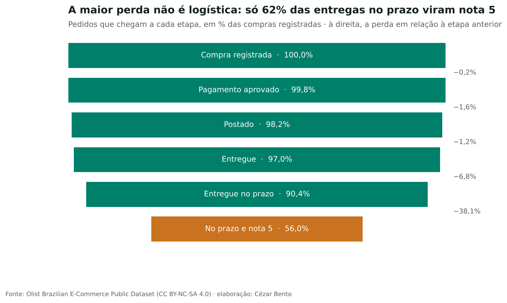

**Leitura:** A operação é eficiente até a entrega (97,0% das compras são entregues) e quase sempre no prazo. A maior queda está na última etapa: de entregue no prazo para no prazo e nota 5, 38% ficam pelo caminho. Ou seja, cumprir o prazo é necessário, mas não basta para encantar: o produto e a experiência pesam na nota máxima.

**Quando usar:** Mostrar etapas sequenciais em que cada uma é um subconjunto da anterior, destacando a maior perda.

[Código](graficos/21_funil.py)

### 22 Diagrama de cordas

**Pergunta:** Entre os maiores estados, quem vende para quem?

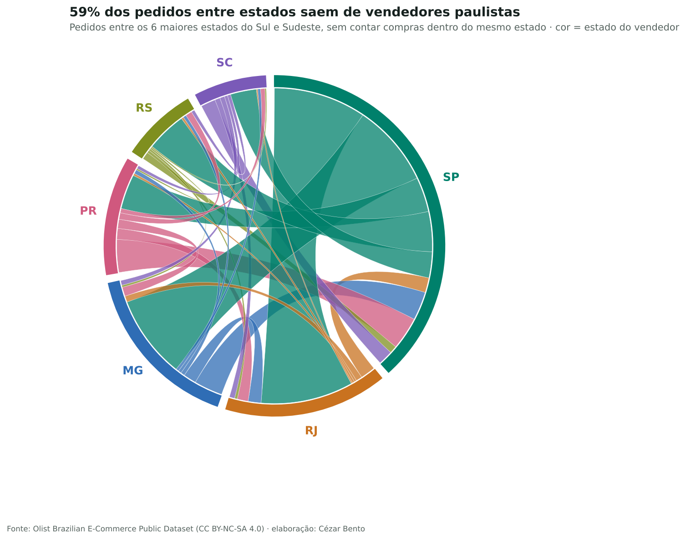

**Leitura:** A maioria das cordas é verde, a cor de SP: 59% dos pedidos entre estados diferentes têm vendedor paulista. Mesmo no estado menos dependente (SC), 73% das compras vindas de fora saem de SP. As compras dentro do próprio estado ficaram de fora porque dominariam o desenho: só SP para SP já é 40% dos pedidos entre esses seis estados. O diagrama foi desenhado do zero; com mais de 8 a 10 entidades ele fica ilegível, e uma matriz de calor passa a ser a melhor saída.

**Quando usar:** Mostrar fluxos de ida e volta entre poucas entidades (até ~10), onde uma matriz de origem e destino é o dado de base.

[Código](graficos/22_chord.py)


## Relação

*Como duas ou mais variáveis andam juntas.*

### 23 Hexbin

**Pergunta:** Quanto o frete pesa em relação ao valor do produto, pedido a pedido?

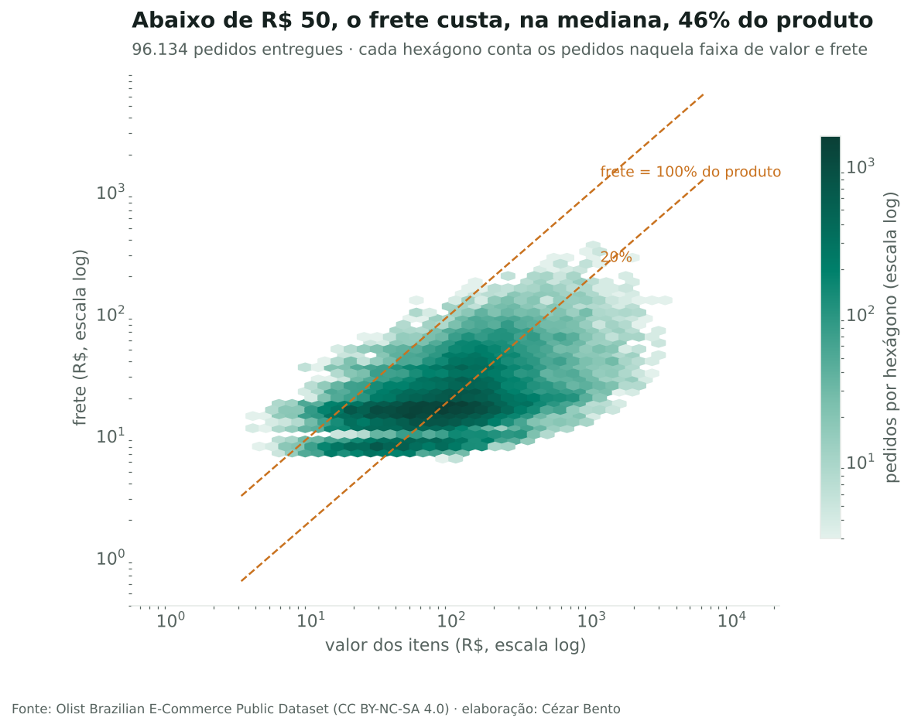

**Leitura:** O frete cresce bem menos que o valor: abaixo de R$ 50 ele é, na mediana, 46% do produto; acima de R$ 500, 4%. Em 3,2% dos pedidos o frete custa mais que o produto. Com 96.134 pontos, um gráfico de dispersão comum viraria uma mancha; o hexbin conta os pontos e mostra onde está a massa dos pedidos.

**Quando usar:** Mostrar a relação entre duas variáveis contínuas com muitos pontos, onde um scatter vira uma mancha sem densidade.

[Código](graficos/23_hexbin.py)

### 24 Matriz de correlação agrupada

**Pergunta:** Quais características dos clientes andam juntas, e quais andam com o cancelamento?

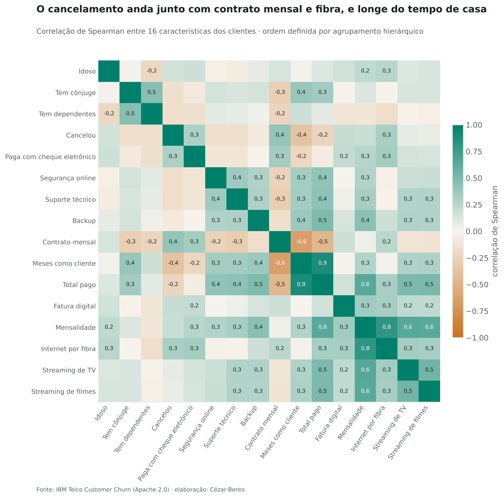

**Leitura:** O agrupamento junta variáveis que contam a mesma história: tempo de casa, total pago e contratos longos formam um bloco; fibra, mensalidade alta e streaming formam outro. O cancelamento se liga a contrato mensal (0,40) e se opõe a meses como cliente (-0,37). Sem reordenar, a mesma matriz pareceria um tabuleiro aleatório. Só os valores com módulo de pelo menos 0,2 aparecem escritos, para não poluir.

**Quando usar:** Explorar muitas variáveis de uma vez; reordenar por agrupamento faz os blocos de variáveis parecidas aparecerem.

[Código](graficos/24_correlacao_agrupada.py)

### 25 Coordenadas paralelas

**Pergunta:** Qual é o perfil, em várias medidas ao mesmo tempo, dos clientes que cancelam?

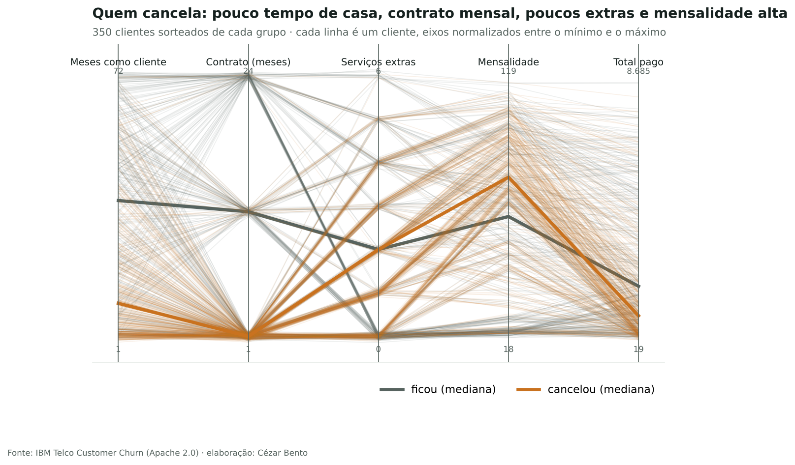

**Leitura:** As linhas laranjas descem no tempo de casa (mediana de 10 meses contra 38 de quem ficou), ficam no piso do contrato e sobem na mensalidade (US$ 80 contra US$ 64). O gráfico mostra o perfil inteiro de uma vez; a ordem dos eixos importa, porque só se leem bem as relações entre eixos vizinhos.

**Quando usar:** Comparar perfis multivariados de grupos (4 a 8 variáveis); funciona melhor com amostras e transparência.

[Código](graficos/25_coordenadas_paralelas.py)

### 26 Rede de coocorrência

**Pergunta:** Quais gêneros de filme costumam aparecer juntos?

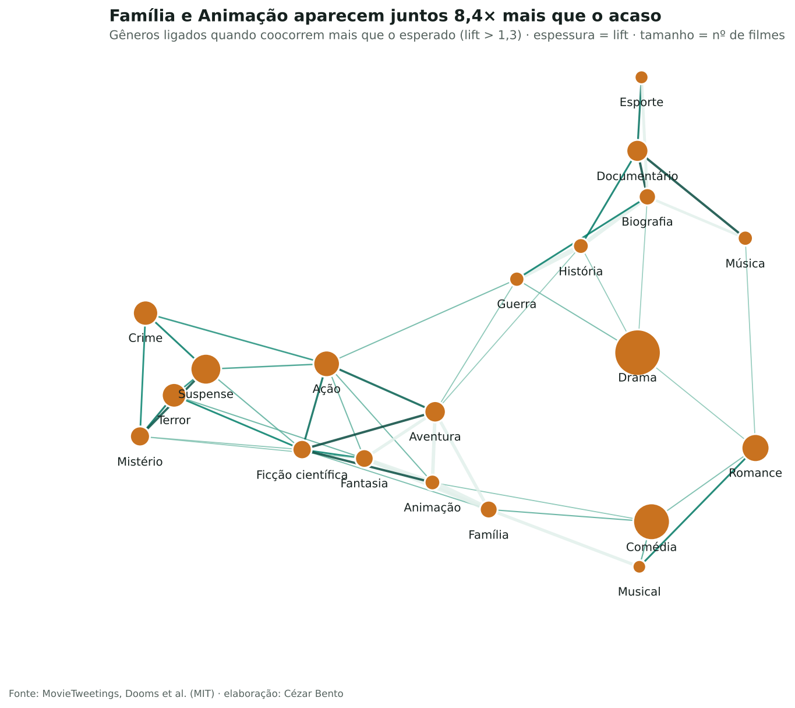

**Leitura:** A ligação usa o lift, não a contagem bruta: Drama aparece com tudo porque é o gênero mais comum, e isso não é afinidade. Pelo lift, Família e Animação são o par mais forte (8,4×), seguidos de História + Guerra (7,1×); História + Biografia (5,9×). Os grupos que surgem (família/animação/aventura, crime/suspense/mistério) são a base de um recomendador por conteúdo.

**Quando usar:** Mostrar relações entre entidades (coocorrência, conexões) quando a estrutura da rede é a mensagem.

[Código](graficos/26_rede.py)

### 27 Mapa de hexágonos

**Pergunta:** Onde ficam os anúncios mais caros do Airbnb em Buenos Aires?

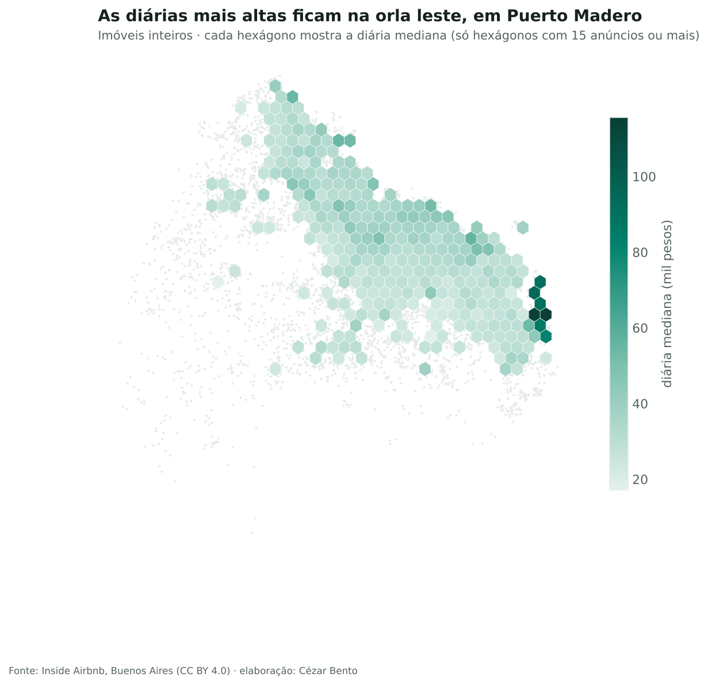

**Leitura:** O mapa usa só latitude e longitude, sem arquivo de fronteiras: os pontos cinza desenham a cidade e os hexágonos mostram a diária mediana. Os hexágonos mais caros estão em Puerto Madero, na orla leste, com mediana de até ARS 115.556; o resto da área central fica numa faixa bem mais estreita. Os pontos cinza fora dos hexágonos são regiões com menos de 15 anúncios, onde a mediana seria instável. O aspecto do gráfico corrige a distorção da longitude, que encolhe longe do equador.

**Quando usar:** Mapear uma métrica por localização com muitos pontos; hexágonos evitam que o mapa vire só um retrato da densidade.

[Código](graficos/27_mapa_hexbin.py)

### 28 Bolhas

**Pergunta:** Estados com entrega mais demorada dão notas mais baixas?

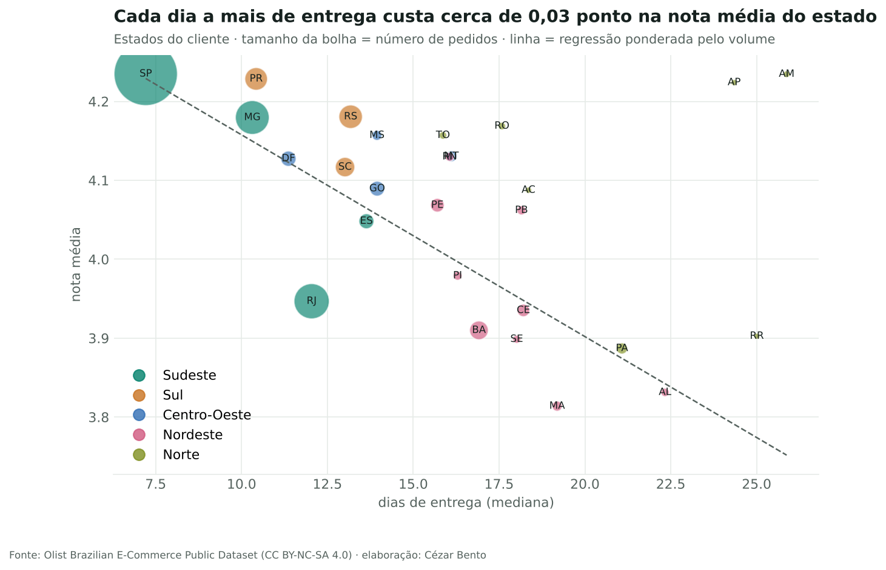

**Leitura:** A correlação entre a mediana de dias de entrega e a nota média dos estados é -0,37. A regressão ponderada pelo volume sugere 0,03 ponto a menos por dia de espera. As bolhas evitam um engano comum: os estados mais extremos são os menores, e sem o tamanho eles pareceriam tão importantes quanto SP. Correlação entre estados não prova o efeito em cada pedido (falácia ecológica); a análise pedido a pedido está no projeto de previsão de demanda.

**Quando usar:** Relacionar duas medidas por categoria e mostrar uma terceira (volume) no tamanho, sem esconder os grupos pequenos.

[Código](graficos/28_bolhas.py)


## Tempo

*Tendência, sazonalidade, choques e previsão.*

### 29 Heatmap de calendário

**Pergunta:** Em quais dias de 2017 a Olist vendeu mais?

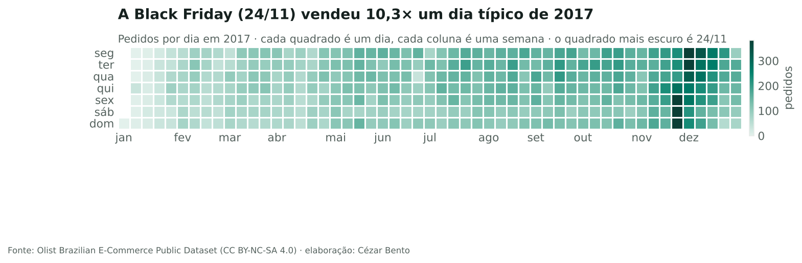

**Leitura:** O calendário mostra três coisas que uma linha diária misturaria: o crescimento ao longo do ano (as colunas escurecem), o padrão semanal (sábados e domingos vendem 25% menos que os dias úteis) e o pico isolado da Black Friday, com 1.176 pedidos em 24/11, 10,3× a mediana diária do ano.

**Quando usar:** Mostrar uma série diária de um ano inteiro, deixando visíveis o padrão semanal e os dias excepcionais.

[Código](graficos/29_calendario.py)

### 30 Streamgraph

**Pergunta:** Como o volume de avaliações de cada gênero evoluiu de 2013 a 2021?

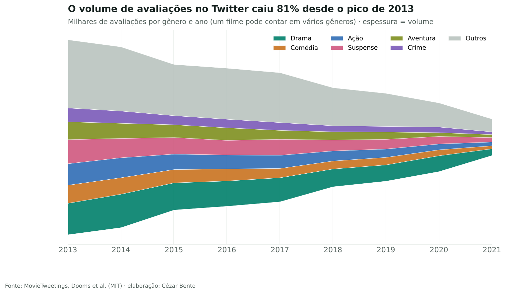

**Leitura:** O streamgraph empilha as camadas em torno de um eixo central que oscila, o que deixa o desenho fluido e chama a atenção para o volume total: o pico foi em 2013 e, até 2021, o volume caiu 81%, provavelmente porque a base só capta tweets gerados automaticamente pelo app do IMDb, um hábito que perdeu força. O custo: sem uma base fixa, comparar a espessura de uma camada entre anos é impreciso. Para análise, pequenos múltiplos (gráfico 12) são melhores; para apresentação, este impressiona.

**Quando usar:** Mostrar o volume total e a mistura de categorias ao longo do tempo de forma expressiva, quando a leitura exata importa menos.

[Código](graficos/30_streamgraph.py)

### 31 Horizon chart

**Pergunta:** Quando cada região vendeu acima ou abaixo do seu próprio ritmo normal?

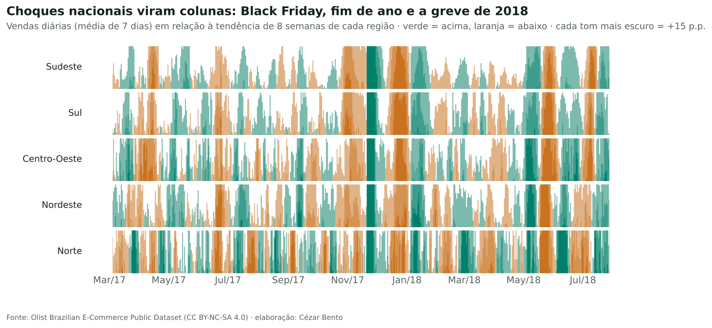

**Leitura:** Cada faixa ocupa a altura de uma linha comum, mas guarda até ±45% de desvio, porque os valores grandes são "dobrados" em tons mais escuros. Assim cinco séries de 17 meses cabem num espaço pequeno. Os choques que atingem o país inteiro aparecem como colunas verticais, da mesma cor em todas as faixas: as festas de fim de ano (abaixo da tendência), a Black Friday de 2017 (até +80% acima da tendência) e a greve dos caminhoneiros em maio de 2018 (até -51%). Ler o horizon chart exige um minuto de treino; em troca, ele permite comparar dezenas de séries.

**Quando usar:** Comparar muitas séries temporais longas em pouco espaço vertical, focando nos desvios.

[Código](graficos/31_horizon.py)

### 32 Fan chart (leque de incerteza)

**Pergunta:** Quantos pedidos esperar nas próximas 12 semanas, e com quanta incerteza?

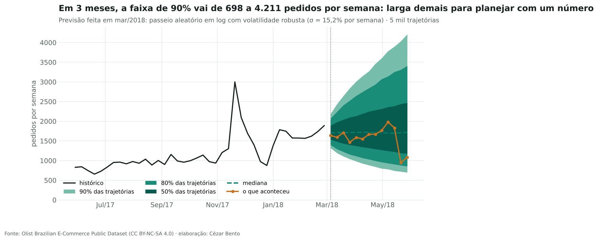

**Leitura:** Cada tom do leque é uma faixa de probabilidade, que se abre com o horizonte porque os erros se acumulam. A previsão central quase não tem informação: é o nível atual. O valor está nas faixas, que dizem para que volume a operação deve estar preparada. Conferindo com o que aconteceu, 13 das 13 semanas ficaram dentro da faixa de 90%, mas a faixa é larga: na 13ª semana vai de 698 a 4.211 pedidos. A semana mais perto da borda inferior é a de 21/05, a greve dos caminhoneiros. É a mesma conclusão do projeto de previsão de demanda: a três meses a incerteza domina, e replanejar toda semana vale mais que um modelo mais sofisticado. A volatilidade foi estimada pela mediana dos desvios (MAD), que não deixa a Black Friday inflar o leque.

**Quando usar:** Comunicar uma previsão sem fingir precisão: as faixas mostram o que é plausível e como a incerteza cresce com o horizonte.

[Código](graficos/32_leque_previsao.py)

### 33 Decomposição de série temporal

**Pergunta:** Quanto da variação diária das vendas é tendência, quanto é dia da semana e quanto é imprevisível?

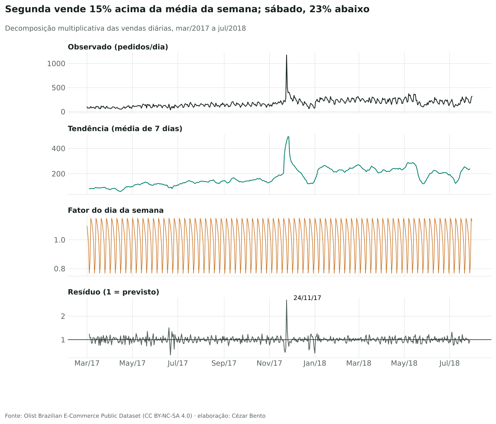

**Leitura:** A decomposição separa a série em três partes que se multiplicam. A tendência mostra o crescimento até o fim de 2017 e a estabilização em 2018. O fator semanal é forte: segunda vende 15% acima da média e sábado 23% abaixo. O resíduo é pequeno na maior parte do tempo (fica com cerca de 11% da variância do log das vendas) e tem o maior desvio em 24/11/2017, a Black Friday. Implementar a decomposição à mão (sem statsmodels) mostra que ela é só médias móveis e médias por grupo.

**Quando usar:** Separar os componentes de uma série antes de modelar ou de interpretar picos e quedas.

[Código](graficos/33_decomposicao.py)

### 34 Heatmap radial (relógio)

**Pergunta:** Em que horas e dias da semana os clientes compram?

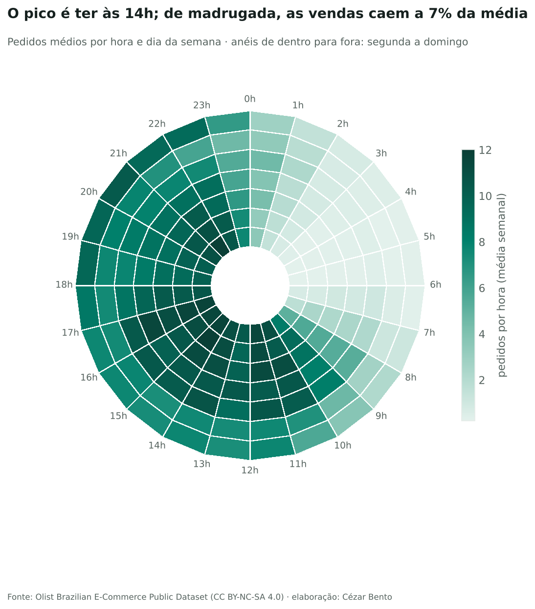

**Leitura:** O relógio torna natural a continuidade entre 23h e 0h, que num heatmap retangular ficaria nas bordas opostas. O pico médio é ter às 14h; entre 2h e 5h as vendas caem a 7% da média. Os fins de semana ficam mais claros durante o dia, mas a noite de domingo recupera (1,4× a de sábado no mesmo horário), um bom horário para campanhas. Ler valores exatos em anéis é difícil: para isso, a versão retangular é melhor.

**Quando usar:** Mostrar padrões cíclicos (horas, meses), em que o fim encosta no começo; a versão retangular é mais precisa para leitura exata.

[Código](graficos/34_radial.py)


## Texto

*O que as pessoas escrevem, em números.*

### 35 Nuvem de palavras

**Pergunta:** Que palavras os clientes insatisfeitos mais usam?

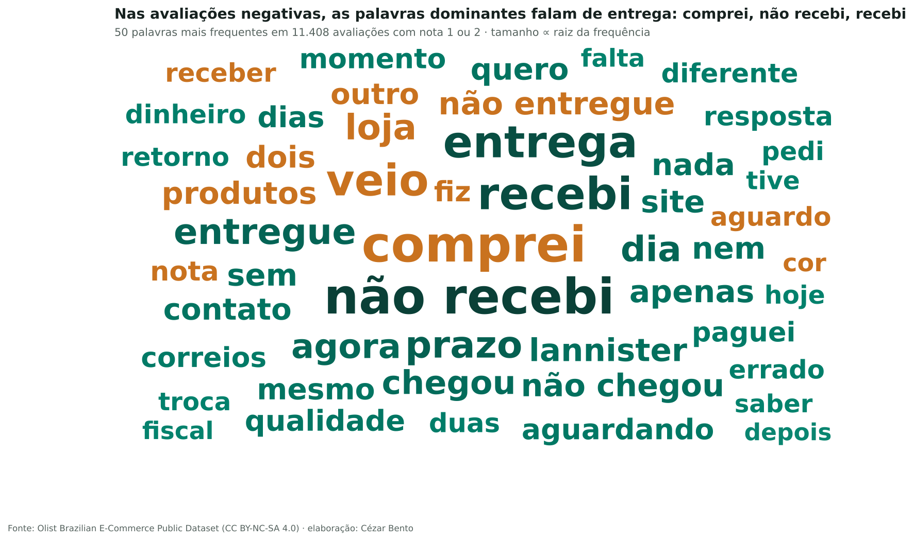

**Leitura:** As maiores palavras (comprei, não recebi, recebi, entrega, veio) contam a história da insatisfação: entrega e prazo. Duas decisões tornam a nuvem útil: as palavras óbvias de qualquer avaliação ('produto', 'pedido', 'compra') foram tiradas, e o 'não' foi juntado à palavra seguinte, porque 'não recebi' e 'recebi' dizem o oposto. A nuvem foi implementada do zero: as palavras andam numa espiral a partir do centro até encontrar espaço livre. Limite: o tamanho de fonte é difícil de comparar e palavras longas parecem mais importantes. Por isso o próximo gráfico refaz a análise com barras.

**Quando usar:** Dar uma primeira impressão de um texto para público amplo; para análise, prefira barras (veja o gráfico seguinte).

[Código](graficos/35_nuvem_de_palavras.py)

### 36 Log-odds de palavras

**Pergunta:** Quais palavras são típicas de avaliações negativas, e não só frequentes?

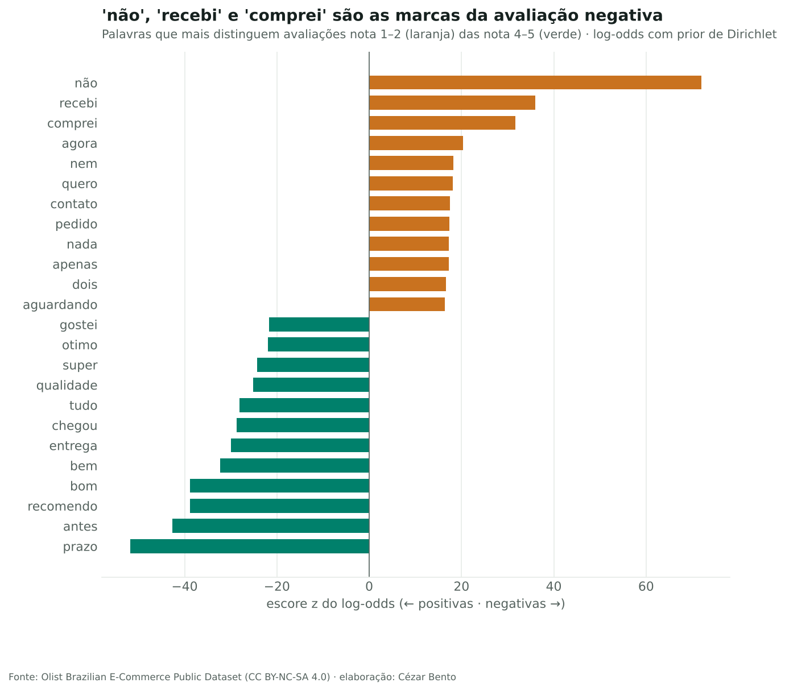

**Leitura:** Diferente da nuvem, este gráfico mede quanto cada palavra é mais típica de um grupo que do outro. Do lado negativo, lideram não, recebi, comprei; do positivo, prazo, antes, recomendo. O método de Monroe et al. encolhe as palavras raras, então nenhum termo entra por aparecer duas vezes por acaso. É o tipo de evidência que alimenta um classificador de sentimento, como no projeto de NLP do repositório de Machine Learning.

**Quando usar:** Comparar o vocabulário de dois grupos de textos; corrige o viés das palavras comuns, que dominam qualquer contagem.

[Código](graficos/36_log_odds.py)


## Incerteza

*Quanto confiar no número: intervalos, testes e diagnóstico de modelos.*

### 37 Forest plot

**Pergunta:** Quais características aumentam ou reduzem a chance de cancelar, descontando as outras?

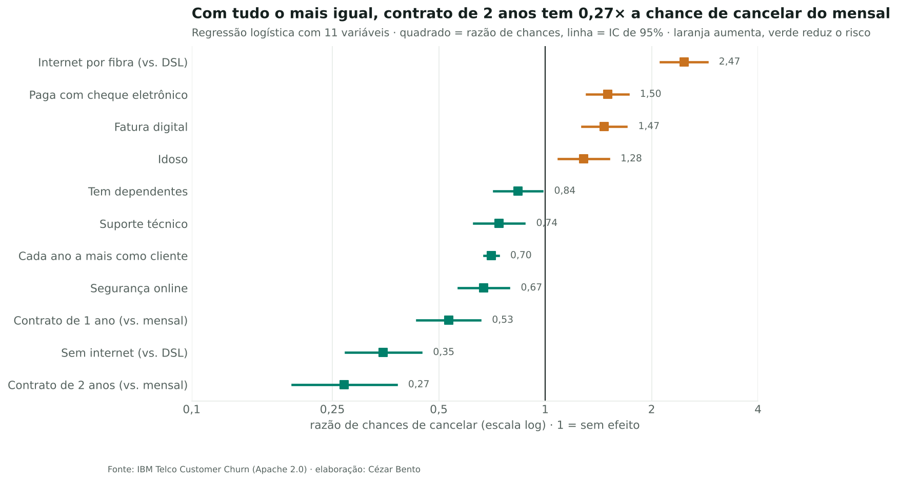

**Leitura:** Cada linha é o efeito de uma característica mantendo as outras fixas, com o intervalo de 95%. Contrato de 2 anos multiplica a chance de cancelar por 0,27 (IC 0,19–0,38); fibra, por 2,47. Intervalos que cruzam a linha do 1 (em cinza) são efeitos que os dados não distinguem de zero. A regressão foi implementada por Newton-Raphson, com os erros-padrão tirados da informação de Fisher. São associações, não efeitos causais: quem escolhe contrato longo já tende a ficar.

**Quando usar:** Mostrar vários efeitos estimados (coeficientes, razões de chance, estudos de uma meta-análise) com a incerteza de cada um.

[Código](graficos/37_forest_plot.py)

### 38 Distribuição de bootstrap

**Pergunta:** Quanto um imóvel inteiro custa a mais que um quarto privativo, e com que precisão sabemos isso?

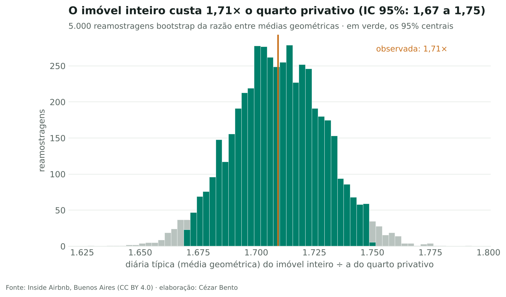

**Leitura:** Não há fórmula simples para o erro-padrão de uma razão entre médias geométricas, mas o bootstrap resolve: reamostrar os anúncios com reposição 5.000 vezes mostra quanto a estatística variaria em outras amostras. A diária típica de um imóvel inteiro é 1,71× a de um quarto privativo, com intervalo de 95% de 1,67 a 1,75. Um detalhe que só aparece fazendo: a razão entre medianas daria um intervalo degenerado (1,75 a 1,75), porque os preços se repetem muito e a mediana fica presa no mesmo valor. A média geométrica, calculada em log, usa todos os dados e varia de forma contínua.

**Quando usar:** Obter intervalo de confiança para medianas, razões ou qualquer estatística sem fórmula simples de erro-padrão.

[Código](graficos/38_bootstrap.py)

### 39 Funnel plot

**Pergunta:** Quais vendedores atrasam mais do que o acaso explicaria, dado o seu volume?

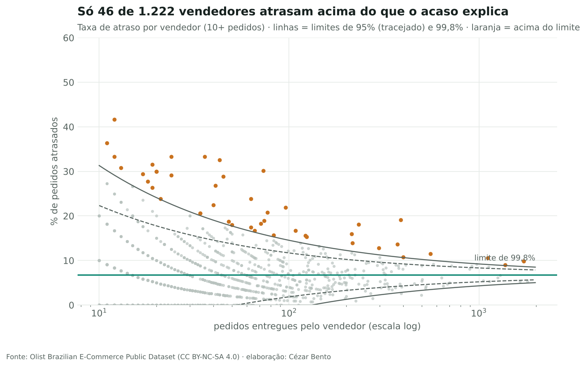

**Leitura:** A taxa média de atraso é 6,8%. Entre os vendedores com menos de 30 pedidos, 90 têm taxa acima do dobro da média, mas quase todos ficam dentro do funil: com tão poucos pedidos, isso é variação normal. Só 46 vendedores passam do limite de 99,8%, e são esses que merecem uma conversa. Um ranking simples de taxa colocaria no topo justamente os pequenos, que tiveram azar.

**Quando usar:** Comparar taxas entre unidades de tamanhos muito diferentes (vendedores, hospitais, lojas) sem punir os pequenos pelo ruído.

[Código](graficos/39_funnel_plot.py)

### 40 Lei de Benford

**Pergunta:** Os valores pagos na Olist seguem a Lei de Benford, como se espera de dados financeiros não manipulados?

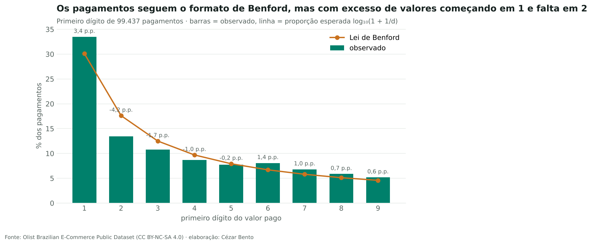

**Leitura:** Em valores que se espalham por várias ordens de grandeza, o dígito 1 aparece em cerca de 30% dos casos e o 9 em menos de 5%. Os pagamentos da Olist seguem esse padrão com desvio absoluto médio de 1,58 p.p., o que pelos critérios de Nigrini é não conformidade: o dígito 1 tem 3,4 p.p. a mais e o 2, 4,2 p.p. a menos. A causa provável é a escala: 32% dos pagamentos estão entre R$ 100 e 199, e Benford pressupõe valores espalhados por várias ordens de grandeza. O qui-quadrado dá p < 0,001, mas com 99.437 valores qualquer desvio mínimo vira significativo: por isso a literatura usa o desvio médio, e não o p-valor. Na prática, Benford serve de triagem para escolher onde auditar, não como prova.

**Quando usar:** Triagem de fraude ou erro em valores que cobrem várias ordens de grandeza (pagamentos, notas fiscais, gastos públicos).

[Código](graficos/40_benford.py)

### 41 Diagnóstico de resíduos

**Pergunta:** Uma regressão linear para o preço do Airbnb cumpre as suposições que dão validade aos intervalos de confiança?

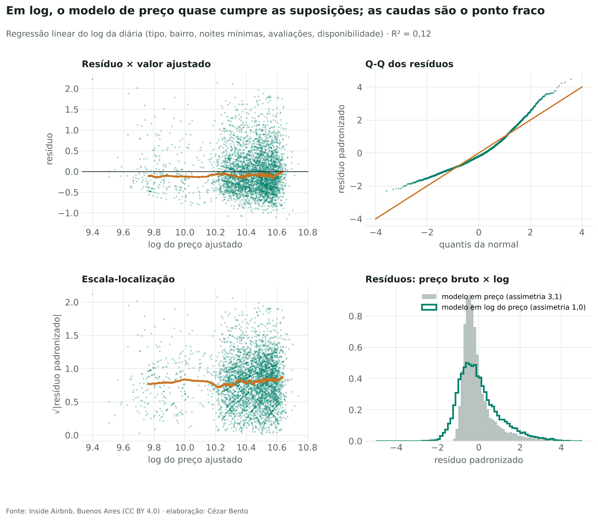

**Leitura:** Os quatro painéis checam as suposições da regressão. O resíduo × ajustado não mostra curvatura forte; a escala-localização mostra variância parecida ao longo dos preços; o Q-Q revela caudas mais pesadas que a normal (1,2% dos resíduos passam de 3 desvios, contra 0,3% esperado). O último painel justifica o log: no preço bruto, os resíduos têm assimetria 3,1; em log, 1,0. Com caudas pesadas, os intervalos de confiança devem vir de erros-padrão robustos ou bootstrap.

**Quando usar:** Sempre depois de ajustar uma regressão: os resíduos mostram não linearidade, variância desigual e caudas pesadas.

[Código](graficos/41_residuos.py)

### 42 Cobertura de intervalos de confiança

**Pergunta:** Se repetíssemos uma pesquisa 100 vezes, quantos intervalos de 95% conteriam o valor verdadeiro?

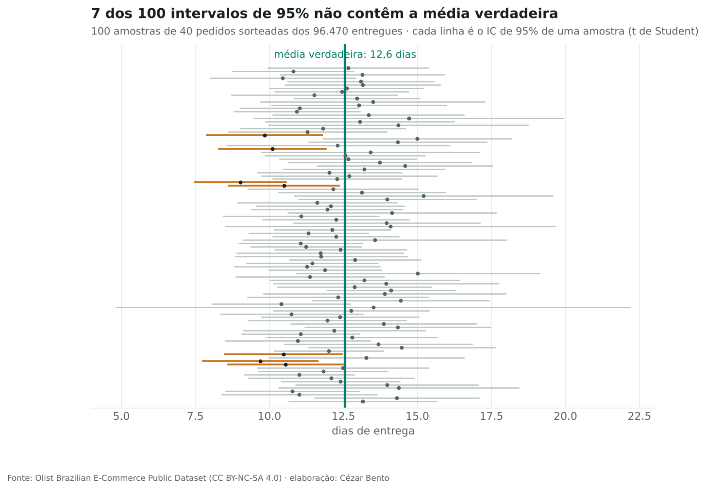

**Leitura:** Aqui a população é conhecida (todos os 96.470 pedidos), então dá para conferir: dos 100 intervalos calculados com amostras de 40 pedidos, 7 não contêm a média verdadeira de 12,6 dias. O "95%" descreve o método ao longo de muitas repetições; um intervalo específico acerta ou erra. Neste sorteio, 7 dos 7 erros ficaram à esquerda da verdade: com dias de entrega assimétricos, as amostras sem nenhum pedido muito atrasado subestimam a média, e o intervalo t, que supõe simetria, não compensa.

**Quando usar:** Explicar incerteza amostral para não estatísticos; mostra que o 95% é sobre o método, não sobre um intervalo específico.

[Código](graficos/42_intervalos.py)


## Errado × certo

*O mesmo dado em um gráfico que engana e em um que informa.*

### 43 Pizza × barras

**Pergunta:** Qual a participação de cada categoria nos pedidos, e qual gráfico responde isso melhor?

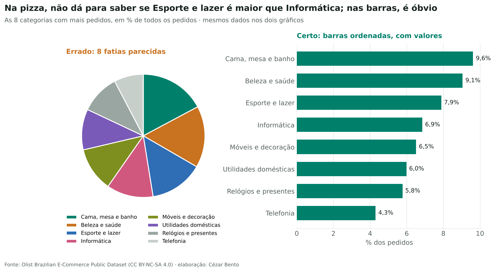

**Leitura:** As oito fatias têm tamanhos parecidos (de 4,3% a 9,6%), e o olho humano compara ângulos e áreas muito pior que comprimentos alinhados. Na pizza, Esporte e lazer (7,9%) e Informática (6,9%) parecem iguais; nas barras, a ordem é imediata. A pizza ainda gasta oito cores e obriga o leitor a ir e voltar da legenda. Ela só funciona com duas ou três fatias bem diferentes, quando a mensagem é 'a maioria'.

**Quando usar:** Barras ordenadas para comparar partes; pizza só com 2 ou 3 fatias muito diferentes, quando a mensagem é 'parte do todo'.

[Código](graficos/43_pizza_vs_barras.py)

### 44 Eixo duplo × índice

**Pergunta:** Pedidos e ticket médio cresceram juntos?

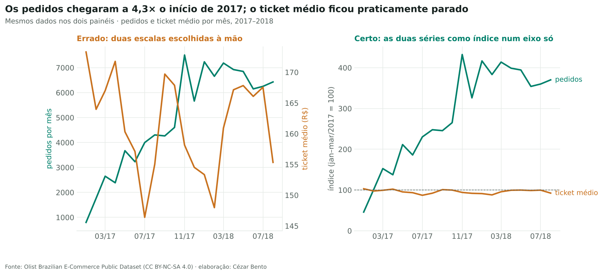

**Leitura:** No painel da esquerda, a escala da direita vai só de R$ 146 a R$ 173: variações de poucos por cento no ticket ganham a mesma altura da triplicação dos pedidos, e as duas linhas parecem disputar a mesma história (a correlação entre elas é -0,35). No índice, com as duas séries na mesma base, a história real aparece: pedidos chegaram a 432 (4,3× o início de 2017) e o ticket ficou entre 87 e 103. Eixo duplo deixa quem desenha escolher a conclusão.

**Quando usar:** Para comparar a evolução de duas grandezas com unidades diferentes, use um índice (base 100) num eixo só.

[Código](graficos/44_eixo_duplo.py)

### 45 Eixo truncado

**Pergunta:** A nota média muda muito entre as regiões?

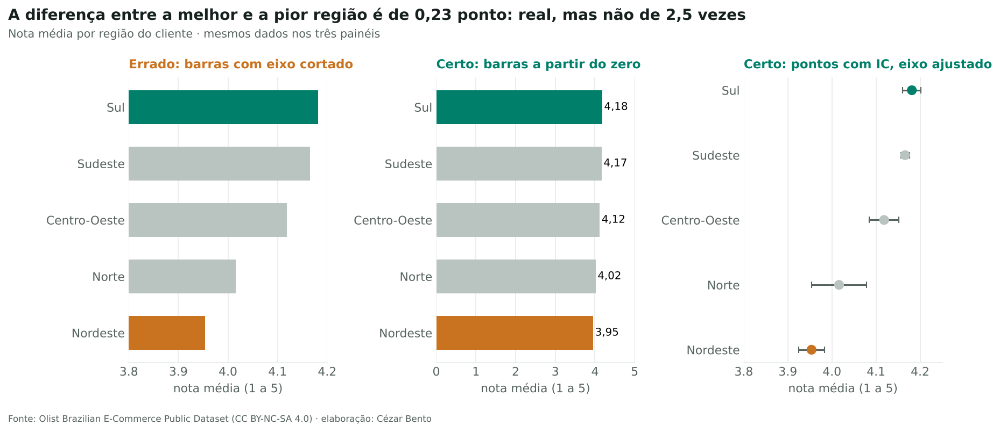

**Leitura:** No primeiro painel, o eixo começa em 3,8 e a barra do Sul parece 2,5× maior que a do Nordeste, quando a diferença real é de 0,23 ponto (5,8%). Barras codificam valor pelo comprimento, então cortar o eixo distorce a comparação. Se a diferença pequena importa, o gráfico de pontos com intervalo de confiança pode usar um eixo ajustado sem enganar, porque a posição, e não o comprimento, carrega o valor, e o intervalo mostra que a diferença é estatisticamente real.

**Quando usar:** Barras sempre começam no zero, porque o comprimento é a mensagem. Para destacar diferenças pequenas, use pontos com eixo ajustado e diga isso.

[Código](graficos/45_eixo_truncado.py)

## Como reproduzir

```bash
pip install -r requirements.txt
python scripts/gerar_galeria.py        # gera os 45 gráficos e este README
python graficos/19_sankey.py           # ou um gráfico só
```

Estrutura: `graficos/` (um script por gráfico + `comum.py` com estilo, dados e utilidades) · `dados/` (bases enxutas, geradas por `scripts/preparar_dados.py`) · `figuras/`.

## Dados

- **Olist:** [Brazilian E-Commerce Public Dataset](https://www.kaggle.com/datasets/olistbr/brazilian-ecommerce) (CC BY-NC-SA 4.0)
- **Airbnb Buenos Aires:** [Inside Airbnb](https://insideairbnb.com/get-the-data/) (CC BY 4.0), sem nomes de anfitriões
- **Telco Customer Churn:** [IBM](https://github.com/IBM/telco-customer-churn-on-icp4d) (Apache 2.0)
- **MovieTweetings:** [Dooms et al.](https://github.com/sidooms/MovieTweetings) (MIT), agregado por filme e ano

---
Cézar Bento · [portfólio](https://cezarcobaink.github.io/WebSite/) · [LinkedIn](https://www.linkedin.com/in/c%C3%A9zar-augusto-bento-a91528a8)
